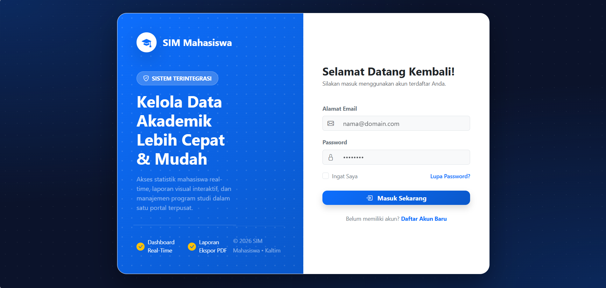
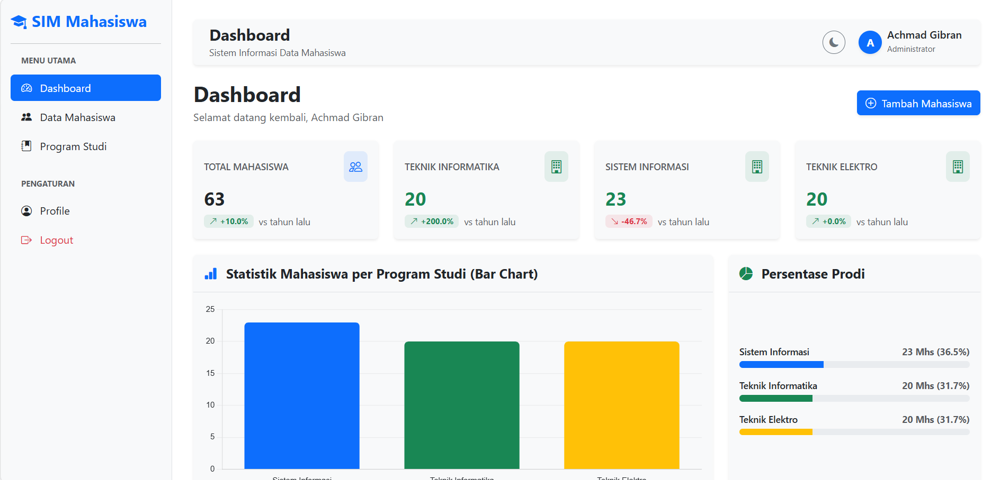
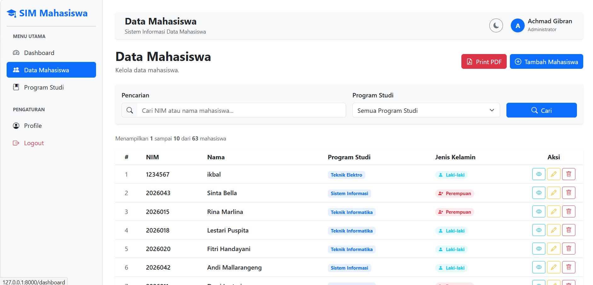
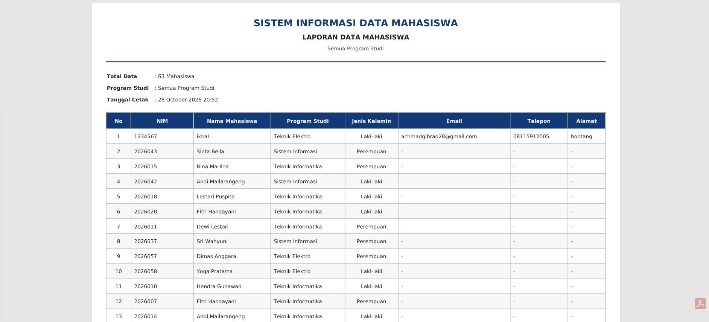
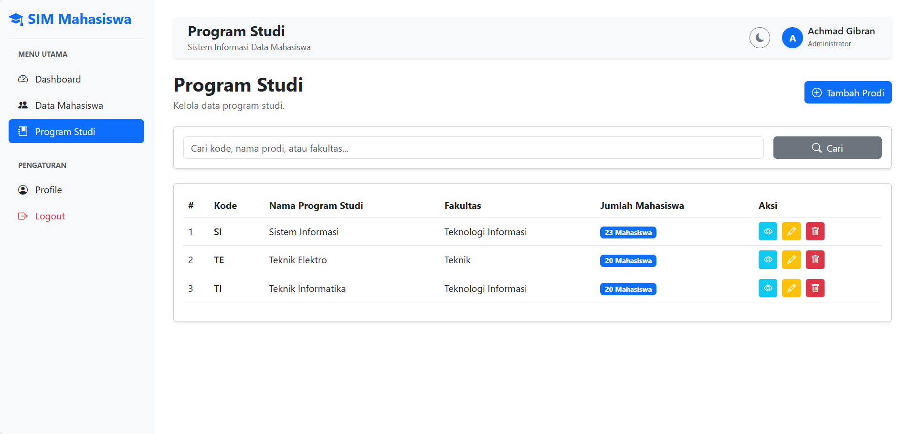
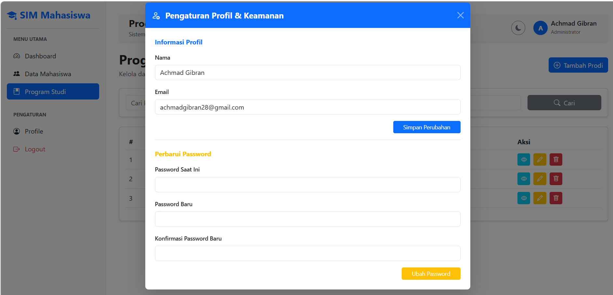

# 🎓 SIM-Mahasiswa

Sistem Informasi Manajemen Mahasiswa berbasis web yang dibangun menggunakan **Laravel**. Aplikasi ini membantu pengelolaan data akademik: mulai dari autentikasi pengguna, pengelolaan data mahasiswa dan program studi, pencetakan laporan PDF, hingga dashboard statistik yang interaktif.


---

## 📑 Daftar Isi

- [Fitur Utama](#-fitur-utama)
- [Tahapan Pengembangan](#-tahapan-pengembangan)
- [Instalasi](#-instalasi)
- [Struktur Data Mahasiswa](#-struktur-data-mahasiswa)
- [Tim Pengembang](#-tim-pengembang)

---

## ✨ Fitur Utama

| Fitur | Deskripsi |
| --- | --- |
| 🔐 Registrasi & Login | Pendaftaran akun dan masuk ke sistem menggunakan email dan password |
| 📊 Dashboard Interaktif | Kartu ringkasan, bar chart per program studi, persentase prodi, serta perbandingan jumlah pendaftar tahun lalu dan tahun ini |
| 👥 Data Mahasiswa | Tambah, lihat, ubah, dan hapus data mahasiswa |
| 🔍 Pencarian & Filter | Cari berdasarkan NIM atau nama, serta filter per program studi |
| 🖨️ Cetak PDF | Laporan data mahasiswa untuk seluruh atau per program studi |
| 🏫 Program Studi | Pengelolaan data program studi lengkap dengan pencarian berdasarkan kode, nama, atau fakultas |
| 👤 Profil & Keamanan | Perbarui nama, email, dan ganti password |
| 🌙 Dark Mode | Tampilan gelap yang dapat diaktifkan kapan saja untuk kenyamanan mata |

---

## 🛠️ Tahapan Pengembangan

Berikut dokumentasi langkah pembuatan SIM-Mahasiswa beserta tangkapan layar di setiap tahap.

### 1. Halaman Login

Halaman masuk ke SIM Mahasiswa. Pengguna yang sudah terdaftar cukup memasukkan **email** dan **password**, lalu menekan tombol **Masuk Sekarang** untuk mengakses sistem. Tersedia juga opsi *Ingat Saya* serta tautan menuju halaman pendaftaran bagi pengguna yang belum memiliki akun. Halaman ini menjadi pintu masuk utama sebelum pengguna dapat mengakses fitur-fitur di dalam aplikasi.



### 2. Halaman Dashboard

Halaman utama yang tampil setelah pengguna berhasil masuk. Dashboard menyajikan ringkasan data secara visual dan real-time, meliputi:

- **Kartu ringkasan** berisi total mahasiswa dan jumlah mahasiswa pada setiap program studi.
- **Fitur persentase pertumbuhan** pada setiap kartu, yang membandingkan jumlah pendaftar **tahun lalu dengan tahun ini** per program studi, lengkap dengan indikator naik atau turun.
- **Bar chart** "Statistik Mahasiswa per Program Studi" untuk membandingkan jumlah mahasiswa antar prodi secara sekilas.
- **Panel Persentase Prodi** yang menampilkan proporsi mahasiswa tiap program studi dalam bentuk progress bar.
- Tombol pintas **Tambah Mahasiswa** serta tombol **dark mode** pada bagian atas halaman.



### 3. Halaman Data Mahasiswa

Halaman untuk mengelola seluruh data mahasiswa dalam bentuk tabel. Fitur yang tersedia:

- **Tambah data**: menambahkan mahasiswa baru melalui form input lengkap.
- **Lihat, ubah, dan hapus**: setiap baris memiliki tombol aksi untuk melihat detail, mengedit, dan menghapus data.
- **Pencarian**: mencari mahasiswa berdasarkan **nama** atau **NIM**.
- **Filter program studi**: menampilkan data mahasiswa dari program studi tertentu saja.
- **Tombol Print PDF**: mencetak data mahasiswa ke dalam format PDF.



### 4. Halaman Cetak PDF

Halaman hasil cetak yang menampilkan data mahasiswa dalam format PDF. Isi laporan menyesuaikan kondisi sebelum tombol **Print PDF** ditekan:

- **Tanpa filter**: laporan memuat data mahasiswa dari **seluruh program studi**.
- **Dengan filter program studi**: laporan hanya memuat data mahasiswa dari **program studi yang dipilih**.

Dengan begitu, pengguna dapat menghasilkan laporan yang sesuai kebutuhan, baik rekap keseluruhan maupun per program studi.



### 5. Halaman Program Studi

Halaman untuk mengelola data program studi. Pengguna dapat **menambahkan program studi baru**, serta **melihat, mengubah, dan menghapus** data yang sudah ada. Halaman ini juga dilengkapi fitur **pencarian** berdasarkan **kode**, **nama program studi**, atau **fakultas**, sehingga data yang dicari dapat ditemukan dengan cepat.



### 6. Halaman Profile

Halaman pengaturan akun dan keamanan. Di sini pengguna dapat memperbarui **nama** dan **email** pada informasi profil, serta **mengganti password** untuk menjaga keamanan akun. Perubahan disimpan langsung ke dalam sistem.



---

## 🚀 Instalasi

> **Prasyarat:** PHP, Composer, Node.js & NPM, serta database (misalnya MySQL).

```bash
# 1. Clone repository
git clone https://github.com/<username>/<nama-repo>.git
cd <nama-repo>

# 2. Install dependensi
composer install
npm install

# 3. Salin file environment dan generate key
cp .env.example .env
php artisan key:generate
```

Atur koneksi database pada file `.env`:

```env
DB_CONNECTION=mysql
DB_HOST=127.0.0.1
DB_PORT=3306
DB_DATABASE=nama_database
DB_USERNAME=root
DB_PASSWORD=
```

Lanjutkan dengan migrasi dan jalankan aplikasi:

```bash
# 4. Migrasi database
php artisan migrate

# 5. Jalankan aplikasi
npm run dev
php artisan serve
```

Buka **http://127.0.0.1:8000** di browser, lalu daftar akun melalui halaman `/register`.

---

## 🗂️ Struktur Data Mahasiswa

| Kolom | Keterangan |
| --- | --- |
| NIM | Nomor induk mahasiswa |
| Nama | Nama lengkap mahasiswa |
| Program Studi | Teknik Informatika, Sistem Informasi, atau Teknik Elektro |
| Jenis Kelamin | Laki-laki / Perempuan |
| Tanggal Lahir | Tanggal lahir mahasiswa |
| Telepon | Nomor telepon aktif |
| Email | Alamat email mahasiswa |
| Alamat | Alamat tempat tinggal |

---

## 👥 Tim Pengembang

| Nama | NIM |
| --- | --- |
| Muhammad Ikbal | 202412008 |
| Achmad Gibran | 202412003 |
| Mosyarofah | 202412032 |
| Vanesa Gladisya Mamanua | 202412021 |
| Sarmila | 202312080 |

---

<p align="center">Dibuat dengan menggunakan Laravel</p>